<picture><source media="(prefers-color-scheme: dark)" srcset="assets/hero-dark.svg"></picture>

<picture><source media="(prefers-color-scheme: dark)" srcset="assets/social-l-dark.svg"></picture><a href="https://t.me/Purp1eDuck"><picture><source media="(prefers-color-scheme: dark)" srcset="assets/social-1-dark.svg"></picture></a><a href="mailto:purpleduck2008@gmail.com"><picture><source media="(prefers-color-scheme: dark)" srcset="assets/social-2-dark.svg"></picture></a><picture><source media="(prefers-color-scheme: dark)" srcset="assets/social-r-dark.svg"></picture>

<picture><source media="(prefers-color-scheme: dark)" srcset="assets/about-dark.svg"></picture>

<picture><source media="(prefers-color-scheme: dark)" srcset="assets/stack-dark.svg"></picture>

<a href="https://github.com/Purp1eDuck2008/Liquid-GRUB"><picture><source media="(prefers-color-scheme: dark)" srcset="assets/project-liquid-grub-dark.svg"></picture></a>&nbsp;<a href="https://github.com/Purp1eDuck2008/EGE-analyzer"><picture><source media="(prefers-color-scheme: dark)" srcset="assets/project-ege-analyzer-dark.svg"></picture></a>

<a href="https://github.com/Purp1eDuck2008/Trezvo"><picture><source media="(prefers-color-scheme: dark)" srcset="assets/project-trezvo-dark.svg"></picture></a>&nbsp;<a href="https://github.com/Purp1eDuck2008/UnitConverter"><picture><source media="(prefers-color-scheme: dark)" srcset="assets/project-unitconverter-dark.svg"></picture></a>

<picture><source media="(prefers-color-scheme: dark)" srcset="assets/stats-dark.svg"></picture>

<picture><source media="(prefers-color-scheme: dark)" srcset="assets/streak-dark.svg"></picture>

<picture><source media="(prefers-color-scheme: dark)" srcset="assets/wave-dark.svg"></picture>

<a href="https://github.com/Purp1eDuck2008?tab=repositories"><picture><source media="(prefers-color-scheme: dark)" srcset="assets/button-1-dark.svg"></picture></a>

<a href="https://metawka.github.io/expressive-profile/?from=Purp1eDuck2008"><picture><source media="(prefers-color-scheme: dark)" srcset="assets/credit-dark.svg"></picture></a>

